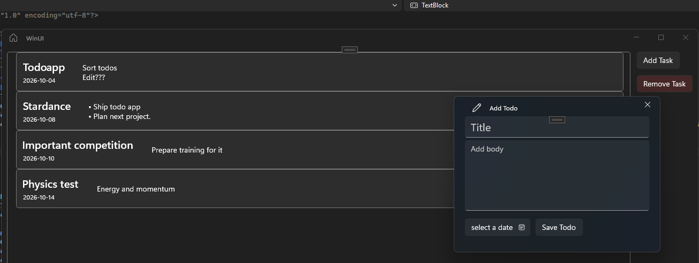

# WinUI Todo
This is a simple todo app made in C# using WinUI3.

### Releases
| File      | Description                      |
|-----------|----------------------------------|
| [WinUI](https://github.com/GamerReaper09/WinUI-Todo/releases/tag/release)     | A msix for the app install (x64) |
| [WinUI.exe](https://github.com/GamerReaper09/WinUI-Todo/releases/tag/exe) | A .exe folder for the app (x64)  |

There are no binaries for x86 or ARM64 but they could potentially be built yourself if they are needed.

### How to run (.msix)
Download the zip from [releases](https://github.com/GamerReaper09/WinUI-Todo/releases/tag/release). Then extract somewhere on the computer. Install the certification **(Important! Make sure to install the certificate into the store named "trusted people", don't let it chose automatically)**. Finally install the msix and enjoy. The app is now available like any other program in the start menu named WinUI.

### How to run (.exe)
Download the zip from [releases](https://github.com/GamerReaper09/WinUI-Todo/releases/tag/exe). Then extract into a folder on the computer. Then find the "WinUI Blank App (Unpackaged).exe". And execute it to run the app. (Sorry for the bad name but it was due to the only solution to making an exe was to use a unpackaged template and rebuild the whole project into that template). Also making a shortcut to the exe is recommended for quick access.

(Notes will probably be shared between .msix version and .exe if both are used)

### Features
* Simple ui
* Buttons that allow easy creation and removal
* Dates for todos
* Unlimited text

### How to run yourself
The repository contains the .slnx and .csproj so it should just be to download it and open in Visual Studio so you can run yourself.

### How it is made
It is made in C# using WinUI3 as a framework. Mostly built with the help of WinUI3 Gallery for examples and names of elements to use.

### Credits
Credits to @xn05 for the [Unpackaged template](https://github.com/xn05/wuiprojectvs-UP) which made an exe release possible.
